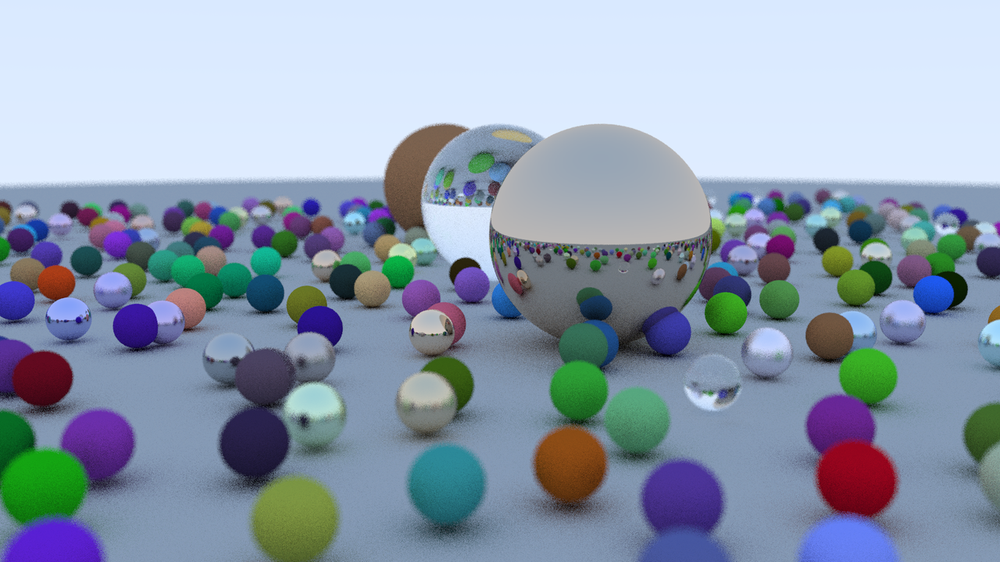

# Wavefront Path Tracing in CUDA

A CUDA path tracer based on *Ray Tracing in One Weekend*, extended with a **wavefront** architecture that can be switched against the original **megakernel** design.

I built this for the Advanced Graphics course at Utrecht University, on top of Roger Allen's CUDA port of the book ([original repo](https://github.com/rogerallen/raytracinginoneweekendincuda), [NVIDIA blog post](https://developer.nvidia.com/blog/accelerated-ray-tracing-cuda/)).



## Megakernel vs. wavefront

The original renderer is a **megakernel**: one thread per pixel traces its entire path, bounce after bounce, inside a single kernel. That is simple, but threads in the same warp diverge as soon as their paths do: one ray hits a metal sphere, the next escapes to the sky, and the warp keeps running until its longest path is done.

The **wavefront** version splits each bounce into separate kernels that run over a buffer of rays:

1. **Generate**: one primary ray per pixel is written to a ray buffer.
2. **Extend**: every ray in the buffer is intersected with the scene, and the hit distance and primitive index are stored on the ray.
3. **Shade**: each hit is shaded using its material. A path that scatters writes its bounce ray to a new buffer through an `atomicAdd` counter, and its throughput is multiplied into a per-pixel accumulator. A path that misses picks up the sky colour and is not continued.

Extend and Shade then repeat on the new buffer, up to 50 bounces per sample. After each Shade pass the host reads the counter back with `cudaMemcpyFromSymbol` and launches the next Extend with exactly that many threads. Because terminated paths never get written to the next buffer, every launch only runs threads for paths that are still alive, which keeps warps full instead of idling on finished paths. The cost is a GPU-to-CPU sync on every bounce; moving the launch size to the device (for example with a persistent-threads loop or CUDA dynamic parallelism) would remove it.

To support this, the scene classes got a second intersection path (`hit_wavefront`) that returns only a distance and primitive index, with normals and materials looked up afterwards in the Shade kernel.

## Results

1920×1080, 10 samples per pixel, up to 50 bounces, on an RTX 4070 (CUDA 13.0). Median of 5 runs; the time covers RNG setup and rendering, not writing the image.

| renderer   | render time | speedup |
| ---------- | ----------- | ------- |
| megakernel | 2.50 s      | 1.0×    |
| wavefront  | 1.18 s      | 2.1×    |

Both renderers produce a pixel-for-pixel identical image: every pixel has its own random state, and both consume it in the same order, so the wavefront version computes exactly the same paths, just scheduled differently.

## Building and running

The project builds on Windows 10/11 with the CUDA toolkit, MSVC (`cl`) and a `make` for Windows. On Linux you can use the Makefile from the original repository.

1. In `jeroen.mk`, set `CUDA_PATH` to your CUDA install and pick `GENCODE_FLAGS` that your GPU supports.
2. Render:
   ```
   make -f jeroen.mk out.jpg
   ```
   This writes `out.ppm` and converts it to `out.jpg` with ImageMagick.

The default is the wavefront renderer; run `cudart.exe --megakernel > out.ppm` for the original one. `ns` in `main()` sets the number of samples per pixel, and the render time is printed to stderr.

`GENCODE_FLAGS` targets `sm_89` (RTX 40 series). CUDA 13 no longer compiles for Pascal and older, so pick the value for your own GPU.
